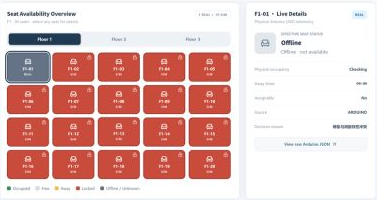
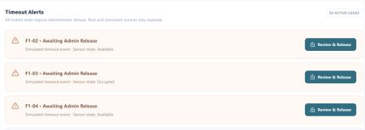
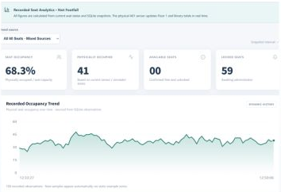
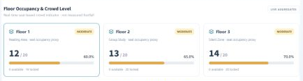

# Dashboard and OLED examples

The screenshots illustrate the interface and device display. Hardware A01 is shown as F1-01 in the floor map; the remaining seats are simulated. Independent example pictures are not a synchronized measurement record.

## Dashboard views

The seat map groups the seats by floor and shows state and data source.

Alerts identify seats requiring staff review. A software lock remains until release is acknowledged.

Analytics summarize real and simulated data according to the selected scope.

Floor statistics represent aggregated seat states; they are not evidence that 60 physical sensor seats were installed.

## Device and dashboard states

| State | OLED example | Dashboard detail | Explanation |
| --- | --- | --- | --- |
| Occupied | [OLED](../images/oled/occupied.png) | [Card](../images/dashboard/occupied-card.png) | Valid evidence indicates a seated user. |
| Temporarily away | [OLED](../images/oled/temporarily-away.png) | [Card](../images/dashboard/temporarily-away-card.png) | Seat is unoccupied while belongings remain; away time accumulates under the firmware rules. |
| Awaiting admin release | [OLED](../images/oled/awaiting-admin-release.png) | [Card](../images/dashboard/awaiting-admin-release-card.png) | The away timeout has latched a software review lock. The Chinese OLED text means timeout awaiting confirmation. |
| Available | [OLED](../images/oled/available.png) | [Card](../images/dashboard/available-card.png) | Availability requires connected, unlocked and physically FREE evidence. |
