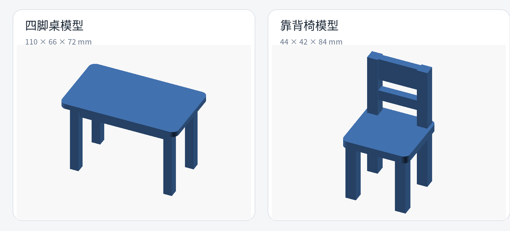

# Prototype 3D design

| Model | Overall dimensions | Printable mesh | Editable OpenSCAD source | Preview |
| --- | --- | --- | --- | --- |
| Table | 110 × 66 × 72 mm | [table_model.stl](table_model.stl) | [table_model.scad](table_model.scad) | [Image](table_preview.png) |
| Chair | 44 × 42 × 84 mm | [chair_model.stl](chair_model.stl) | [chair_model.scad](chair_model.scad) | [Image](chair_preview.png) |

Dimensions are width × depth × overall height. The chair seat top is 43 mm above the base. The SCAD sources use millimetres and describe approximately 1:10-scale furniture models. Open a SCAD file in OpenSCAD to edit the dimensions, render the model and export a new STL. Open the STL in a slicer for printing.

The dimensions above were checked against both the source parameters and the supplied STL vertex bounds. Printer material, layer height, infill and support settings are not encoded as verified print settings in these design files.
