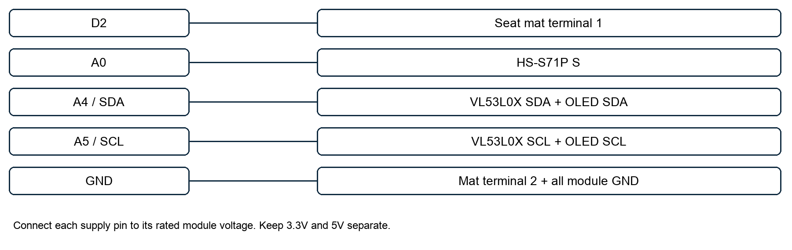
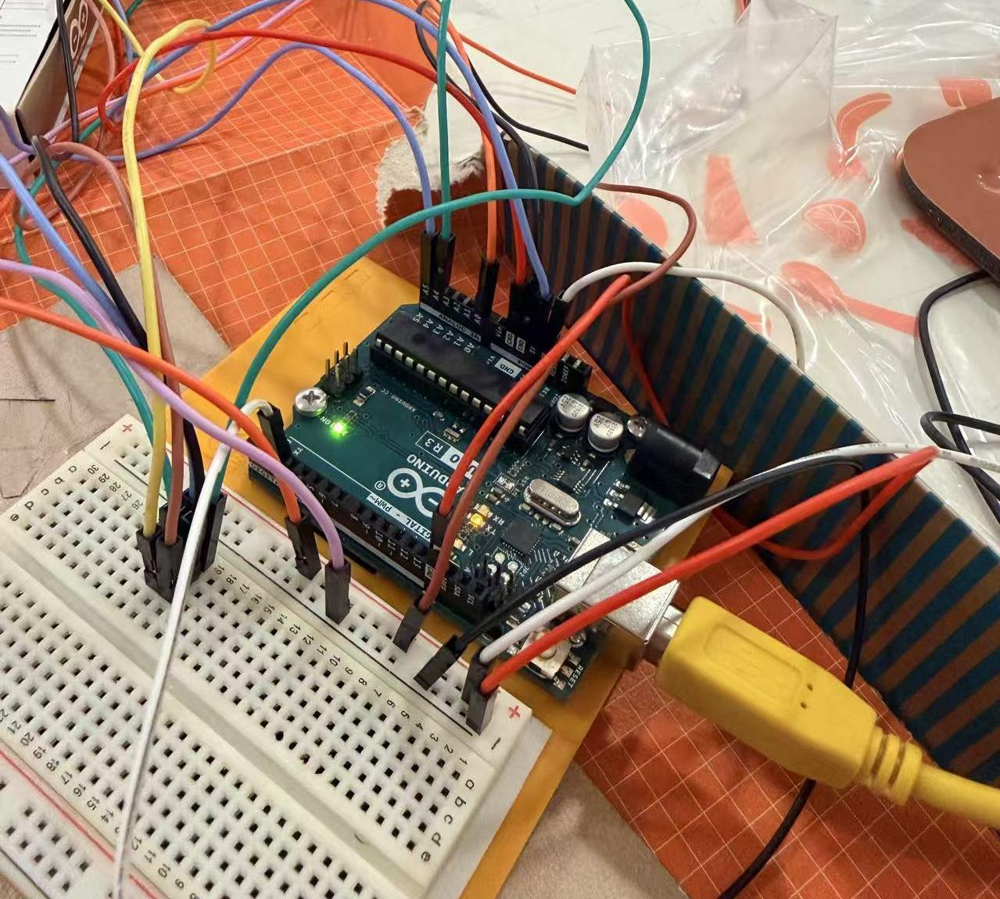

# SeatSense hardware

See the [English manual](../docs/SeatSense_User_Manual.pdf) for the full assembly, calibration and operation procedures.

## Wiring references

| Part | UNO connection | Explanation |
| --- | --- | --- |
| Seat pressure mat | D2 and GND | Digital input; LOW means triggered in the sketch |
| Tray pressure module | Signal to A0, shared GND, appropriate module supply | Use the analogue output configuration; sketch uses 300/500 hysteresis |
| VL53L0X | SDA to A4, SCL to A5, shared GND, appropriate module supply | Shares I2C with the OLED |
| OLED | SDA to A4, SCL to A5, shared GND, appropriate module supply | SSD1306 128 × 64 display using U8x8 text mode |
| UNO | USB to computer | Power and 9600-baud JSON Lines communication |

Disconnect USB before changing wiring. Identify each module's power pin and voltage rating from its markings and documentation; do not assume every VIN/VCC accepts 5 V. Keep SDA and SCL separate. The optional LED outputs in the sketch are disabled and are not required for this build.

[Second overall view](../images/wiring/overall-wiring-02.png) · [Shared power](../images/wiring/shared-power-bench.png) · [Shared I2C](../images/wiring/shared-i2c-bench.png)

## Components and assembly

| Item or step | Photograph |
| --- | --- |
| UNO and breadboard | [Photo](../images/components/arduino-uno-breadboard.png) |
| Seat pressure mat | [Photo](../images/components/seat-pressure-mat.png) |
| Tray pressure module | [Photo](../images/components/tray-pressure-module.png) |
| Distance module | [Photo](../images/components/vl53l0x-module.png) |
| OLED | [Photo](../images/components/oled-module.png) |
| Jumper wires | [Photo](../images/components/jumper-wires.png) |
| Seat mat connection | [Photo](../images/assembly/seat-mat-connection.png) |
| Pressure module pins and wiring | [Close-up](../images/assembly/pressure-module-closeup.png), [bench wiring](../images/assembly/pressure-module-wiring.png) |
| Distance module pins and wiring | [Pins](../images/assembly/distance-module-pins.png), [bench wiring](../images/assembly/distance-module-wiring.png) |
| OLED connection | [Wiring](../images/assembly/oled-wiring.png), [powered display](../images/assembly/oled-powered.png) |
| Assembled prototype | [Side](../images/assembly/prototype-side.png), [front](../images/assembly/prototype-front.png) |

Mount the seat mat where sitting transfers pressure to it. The tray must transfer an object's load into the pressure sensor. Aim the chair-back distance sensor at the seated user and verify the installed distance range. Calibrate with the installed materials rather than treating the supplied thresholds as measured performance.

## 3D design

[Editable designs, STL files, previews and dimensions](3d-design/README.md)
